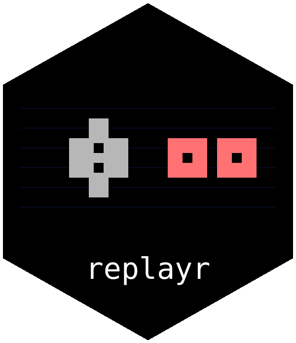

# replayr 

`replayr` imports emulator input recordings into R for analysis. It reads
buttons, keyboard keys, analogue sticks, mouse movement, touch, and motion
sensors, together with recording metadata and timing information.

## Formats and platforms

The package reads 33 recording formats, under 37 file extensions, from
BizHawk, Dolphin, FCEUX, libTAS, Mupen64, Snes9x, openMSX, and other
recording tools, the demos of the Doom and Half-Life engines, and the tables
of two published data sets of human play on the Atari 2600, the Atari Grand
Challenge data set and Atari-HEAD. Supported platforms include:

| Family | Platforms |
|---|---|
| Arcade and application platforms | Adobe Flash; Android; Arcade; IBM PC compatible; IBM PC DOS; Java 2 Platform, Micro Edition (J2ME); Mac OS / macOS; PICO-8; TIC-80; Web. |
| Atari | Atari 2600; Atari 7800; Atari Jaguar; Atari Jaguar CD; Atari Lynx. |
| Home computers and calculators | Amiga; Apple II; Commodore 64; MSX Home Computer System; Spectravideo SVI-318/328; Texas Instruments TI-83 Series; ZX Spectrum. |
| NEC | NEC PC-98; PC Engine / TurboGrafx-16; PC Engine CD / TurboGrafx-CD; PC-FX; SuperGrafx. |
| Nintendo | Famicom Disk System; Game Boy; Game Boy Advance; Game Boy Color; Nintendo 3DS; Nintendo 64; Nintendo 64DD; Nintendo DS; Nintendo DSi; Nintendo Entertainment System / Famicom; Nintendo GameCube; Satellaview; Super Game Boy; Super Nintendo / Super Famicom; Virtual Boy; Wii. |
| Other consoles | 3DO; CD-i; ColecoVision; Fairchild Channel F; Intellivision; Neo Geo Pocket; Odyssey 2 / Videopac; Sony PlayStation; Uzebox; Vectrex; WonderSwan. |
| Sega | Game Gear; Sega 32X; Sega CD / Mega-CD; Sega Genesis / Mega Drive; Sega Master System; Sega Saturn; Sega SG-1000. |

The [compatibility catalogue](COMPATIBILITY.md) lists each format, version,
controller variant, and platform combination. Some desktop and browser games
use input recorded through a host application such as libTAS or Hourglass;
the catalogue identifies these cases. It is also included in the installed
package: `vignette("compatibility", package = "replayr")`. The readers were
checked against published files; the repository's
[validation folder](https://github.com/tp451/replayr/tree/main/validation)
lists the source of every file and provides the scripts to repeat the checks.

## Getting started

Install from GitHub:

```r
# install.packages("remotes")
remotes::install_github("tp451/replayr")
```

Read a recording and summarise the use of one controller:

```r
library(replayr)

path <- system.file("extdata", "paper", "hold.fm2", package = "replayr")
movie <- read_movie(path)
input <- player(movie, 1L)
sort(colMeans(input), decreasing = TRUE)  # Proportion held
```

`read_movie()` chooses the reader from the file extension. `player()` returns a
logical matrix with observations in rows and controls in columns. A `TRUE`
value means that the control is active. The example file contains sustained
Right and B input with brief A presses. Package examples are original
artificial recordings.

## Controllers and analogue input

Each recording has compact columns for its controls. Shared identifiers make
comparable controls match across devices; `button_layout(movie)` gives the
mapping, and `align_buttons()` aligns matrices from several recordings.

See the [universal controller layout](CONTROLLERS.md) for the shared identifiers.

Recorded numeric values are available through `analog_channels()`, in columns
named by key (`left_x`, `mouse_dx`); `channel_layout(movie)` lists the labels
of the recording. Stick input can additionally be represented as four or
eight directions, an angle, or an angle with magnitude. Choose a
representation for each stick:

```r
path <- system.file("extdata", "sample.dtm", package = "replayr")
movie <- read_movie(path,
  analog = c(left = "angle+magnitude", right = "cardinal8"))
```

The original coordinates remain available. Mouse, touch, light-gun, and motion
values retain the units supplied by their recording format.

Rows follow the source recording: they may be frames, controller polls, or
timestamped events. `n_observations()` counts imported observations. Readers retain
available timing information and identify polls whose controller port is
unknown, so these distinctions can be handled in an analysis.
`recording_info()` reports platform, video standard, frame rate and rerecord
count under one name each, whatever the format calls them, and
`observation_time()` gives the time of each observation in seconds.

## Documentation

Open `vignette("replayr", package = "replayr")` for examples of button summaries,
controller alignment, mouse movement, and Wii motion. Reader help pages describe
format-specific options; `?read_bk2_chunks` explains how to process large BK2
recordings in chunks.

## Author and license

Thorben Pelzer (<thorben@pelzer.blog>). GPL version 2 or later.
Format sources and attribution are listed in [inst/COPYRIGHTS](inst/COPYRIGHTS).
