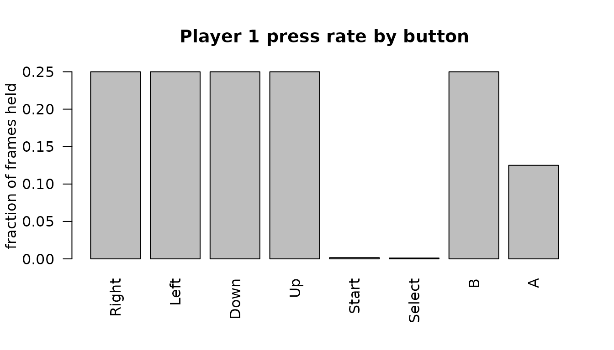

# Reading emulator movie files with replayr

``` r

library(replayr)
```

`replayr` decodes emulator movie (“input log”) files into a uniform
in-memory representation so the same downstream code works whether the
file came off an FCEUX recorder, a BizHawk session, or a 2008-era PSXjin
run. This vignette walks through the API on a single bundled sample.

## Reading a movie

Every reader returns a `replayr_movie` S3 object. Use
[`read_movie()`](../reference/read_movie.md) to dispatch on file
extension automatically:

``` r

fp <- system.file("extdata", "sample.fm2", package = "replayr")
mv <- read_movie(fp)
mv
#> <replayr_movie [fm2] frames=3600 players=2 buttons=8 source=sample.fm2>
#> Header keys: version, emuVersion, rerecordCount, palFlag, romFilename, comment
#> P1 presses: Right=900, Left=900, Down=900, Up=900, Start=6, Select=4, B=900, A=450
```

The bundled `sample.fm2` is a deterministic synthetic NES controller
stream generated by replayr. It contains no ROM or published movie data.
The `print` method shows that the stream is 3,600 frames long, has two
player slots, uses eight universal-button slots, and lists every button
slot that player 1 holds at least once.

## The `replayr_movie` object

Underneath the print method, every parsed movie is just a list:

``` r

str(mv, max.level = 1L, give.attr = FALSE)
#> List of 6
#>  $ header          :List of 6
#>  $ commands        : int [1:3600] 0 0 0 0 0 0 0 0 0 0 ...
#>  $ inputs          : logi [1:3600, 1:2, 1:8] TRUE TRUE TRUE TRUE TRUE TRUE ...
#>  $ source_path     : chr "/home/runner/work/_temp/Library/replayr/extdata/sample.fm2"
#>  $ button_mnemonics: chr [1:8] "R" "L" "D" "U" ...
#>  $ button_names    : chr [1:8] "Right" "Left" "Down" "Up" ...
```

- `header` — named list of header keys (e.g. `version`, `emuVersion`,
  `romFilename`, `rerecordCount`). Plus a synthetic `_format` entry that
  records which parser produced the movie.
- `commands` — integer vector of length `n_frames`. Per-frame commands
  byte (Reset, Power, format-specific bits). Most movie frames are 0.
- `inputs` — logical 3D array, dimensions
  `(n_frames, n_players, n_buttons)`. `TRUE` means the button was held
  that frame.
- `source_path` — where the movie was loaded from.
- `button_mnemonics` / `button_names` — single-character and
  human-readable labels for the third dimension.

Three helpers tell you the array’s shape without poking at
[`dim()`](https://rdrr.io/r/base/dim.html) directly:

``` r

c(n_frames(mv), n_players(mv), n_buttons(mv))
#> [1] 3600    2    8
```

## Inspecting one player

[`player()`](../reference/player.md) extracts a single player’s frames
as a 2D logical matrix with named columns:

``` r

p1 <- player(mv, 1L)
dim(p1)
#> [1] 3600    8
head(p1)
#>         R     L     D     U     T     S     B     A
#> [1,] TRUE FALSE FALSE FALSE  TRUE  TRUE  TRUE  TRUE
#> [2,] TRUE FALSE FALSE FALSE FALSE FALSE  TRUE  TRUE
#> [3,] TRUE FALSE FALSE FALSE FALSE FALSE  TRUE  TRUE
#> [4,] TRUE FALSE FALSE FALSE FALSE FALSE  TRUE  TRUE
#> [5,] TRUE FALSE FALSE FALSE FALSE FALSE  TRUE FALSE
#> [6,] TRUE FALSE FALSE FALSE FALSE FALSE FALSE FALSE
```

[`press_counts()`](../reference/press_counts.md) is the typical first
thing you want — total frames each button was held:

``` r

press_counts(mv, 1L)
#>  Right   Left   Down     Up  Start Select      B      A 
#>    900    900    900    900      6      4    900    450
```

The counts expose the fixture’s repeating movement and button-pulse
patterns. This deliberately simple signal makes parser regressions easy
to spot without depending on gameplay from a third-party movie.

## A quick visual

A press-rate barplot makes the same data immediately legible:

``` r

counts <- press_counts(mv, 1L)
rates  <- counts / n_frames(mv)
barplot(rates,
        las = 2,
        ylab = "fraction of frames held",
        main = "Player 1 press rate by button")
```



## The universal button layout

The `inputs` array’s third dimension is always a prefix of a single
40-slot universal-button alphabet. Slots 1..8 are NES-shaped (Right,
Left, Down, Up, Start, Select, B, A); higher slots cover the features
other consoles add (SNES X / Y / shoulders, Genesis C / Mode, N64
C-buttons, an 8-direction stick quantisation, PSX L2 / R2). Slots 31..40
are the Intellivision / ColecoVision numeric keypad (digits 0-9):


replayr universal-button layout

INTV’s *Enter* / *Clear* and Coleco’s *Star* / *Pound* are not given
their own slots — they fold into Start (slot 5) and Select (slot 6),
since on those platforms they’re pressed once at boot rather than as
gameplay verbs.

``` r

data.frame(slot = seq_along(universal_buttons()),
           mnemonic = universal_buttons(),
           label = universal_button_names())
#>    slot mnemonic      label
#> 1     1        R      Right
#> 2     2        L       Left
#> 3     3        D       Down
#> 4     4        U         Up
#> 5     5        T      Start
#> 6     6        S     Select
#> 7     7        B          B
#> 8     8        A          A
#> 9     9        x          X
#> 10   10        y          Y
#> 11   11        p L-shoulder
#> 12   12        q R-shoulder
#> 13   13        C          C
#> 14   14        Z          Z
#> 15   15        M       Mode
#> 16   16        #      extra
#> 17   17        >    C-Right
#> 18   18        <     C-Left
#> 19   19        v     C-Down
#> 20   20        ^       C-Up
#> 21   21        e    Stick-E
#> 22   22        f   Stick-NE
#> 23   23        n    Stick-N
#> 24   24        g   Stick-NW
#> 25   25        w    Stick-W
#> 26   26        h   Stick-SW
#> 27   27        s    Stick-S
#> 28   28        i   Stick-SE
#> 29   29        [         L2
#> 30   30        ]         R2
#> 31   31        0   Keypad-0
#> 32   32        1   Keypad-1
#> 33   33        2   Keypad-2
#> 34   34        3   Keypad-3
#> 35   35        4   Keypad-4
#> 36   36        5   Keypad-5
#> 37   37        6   Keypad-6
#> 38   38        7   Keypad-7
#> 39   39        8   Keypad-8
#> 40   40        9   Keypad-9
```

A platform fills only the slots it needs:

| Platform / format(s)            | `n_buttons` |
|---------------------------------|-------------|
| NES (.fm2, .fcm, .bk2-NES)      | 8           |
| Game Boy / GBC (.vbm, .lsmv-GB) | 8           |
| GBA (.vbm-GBA, .bk2-GBA)        | 12          |
| SNES (.smv, .lsmv, .bk2-SNES)   | 12          |
| Sega Master System (.bk2-SMS)   | 12          |
| Sega Genesis (.gmv)             | 15          |
| Sega Saturn (.bk2-SAT)          | 15          |
| PC Engine / TG-16 (.bk2-PCE)    | 15          |
| Arcade (.bk2-MAME)              | 15          |
| N64 (.m64, .bk2-N64)            | 28          |
| GameCube (.dtm)                 | 28          |
| PSX (.pxm, .pjm, .bk2-PSX)      | 30          |
| ColecoVision (.bk2-Coleco)      | 40          |
| Intellivision (.bk2-INTV)       | 40          |

This is what makes cross-platform analysis tractable: the same column
index always means “B button”, whether the source movie was .fm2, .smv,
or .pjm.

## Reading other formats

Every supported extension dispatches through the same entry point:

``` r

supported_formats()
#>  [1] ".fm2"  ".bk2"  ".fcm"  ".lsmv" ".gmv"  ".vbm"  ".m64"  ".smv"  ".pxm" 
#> [10] ".pjm"  ".dtm"  ".lmp"
```

Bundled samples live next to the FM2 one:

``` r

bundled <- list.files(system.file("extdata", package = "replayr"),
                      pattern = "^sample\\.", full.names = TRUE)
basename(bundled)
#>  [1] "sample.bk2"  "sample.dtm"  "sample.fcm"  "sample.fm2"  "sample.gmv" 
#>  [6] "sample.lmp"  "sample.lsmv" "sample.m64"  "sample.pjm"  "sample.pxm" 
#> [11] "sample.smv"  "sample.vbm"
```

Try one for any format — the API is identical:

``` r

mv_bk2 <- read_movie(system.file("extdata", "sample.bk2", package = "replayr"))
mv_bk2
#> <replayr_movie [bk2] frames=3600 players=1 buttons=8 source=sample.bk2>
#> Header keys: MovieVersion, Platform, Core, GameName, Author, comment
#> P1 presses: Right=900, Left=900, Down=900, Up=900, Start=6, Select=4, B=900, A=450
press_counts(mv_bk2, 1L)
#>  Right   Left   Down     Up  Start Select      B      A 
#>    900    900    900    900      6      4    900    450
```

This synthetic BK2 fixture declares an NES controller, so it uses the
same eight-slot layout as the FM2 fixture even though the container
format is different. That makes it useful for checking that two readers
produce equivalent button semantics from independently encoded inputs.
