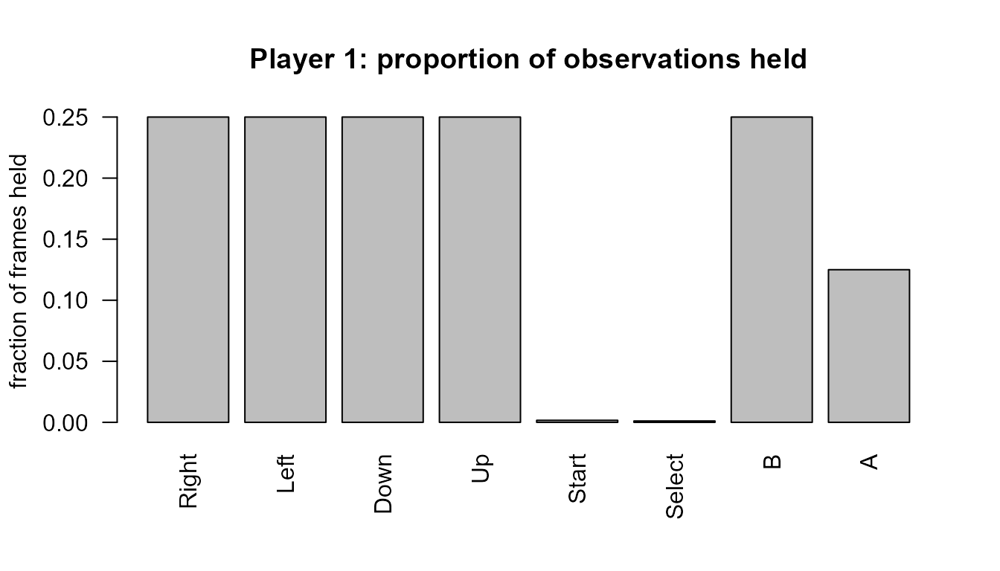

# Reading emulator movie files with replayr

``` r

library(replayr)
```

Emulator movies record the inputs used during play. `replayr` reads
their buttons, keys, numeric device channels, and timing fields into S3
objects for analysis in R. This vignette starts with an artificial NES
recording, then shows how to inspect analogue sticks, mouse movement,
and Wii motion fields. All examples are original recordings supplied
with the package.

## Reading a movie

Assigned controller recordings use the S3 class `replayr_movie`. Ordered
polls with unknown ports and heterogeneous device polls use
`replayr_poll_stream`. Use [`read_movie()`](../reference/read_movie.md)
to dispatch on the file extension:

``` r

fp <- system.file("extdata", "sample.fm2", package = "replayr")
mv <- read_movie(fp)
mv
#> <replayr_movie [fm2] observations=3600 players=2 buttons=8 source=sample.fm2>
#> Header keys: version, emuVersion, rerecordCount, palFlag, romFilename, comment
#> P1 active observations: Right=900, Left=900, Down=900, Up=900, Start=6, Select=4, B=900, A=450
```

The bundled `sample.fm2` contains repeating directional movement and
button pulses for two NES controllers. The `print` method shows that the
stream is 3,600 frames long, has two player slots, uses eight compact
button columns, and identifies its source file.

## The `replayr_movie` object

The object is an S3 list containing the imported input and metadata:

``` r

str(mv, max.level = 1L, give.attr = FALSE)
#> List of 18
#>  $ header          :List of 7
#>  $ commands        : int [1:3600] 0 0 0 0 0 0 0 0 0 0 ...
#>  $ inputs          : logi [1:3600, 1:2, 1:8] TRUE TRUE TRUE TRUE TRUE TRUE ...
#>  $ source_path     : chr "C:/Users/golds/Documents/pisa/publication-audit/latest-library/replayr/extdata/sample.fm2"
#>  $ button_mnemonics: chr [1:8] "R" "L" "D" "U" ...
#>  $ button_names    : chr [1:8] "Right" "Left" "Down" "Up" ...
#>  $ analog          :List of 2
#>  $ analog_mode     : chr "raw"
#>  $ stick_overrides :List of 2
#>  $ button_ids      : int [1:8] 1 2 3 4 5 6 7 8
#>  $ button_keys     : chr [1:8] "dpad_right" "dpad_left" "dpad_down" "dpad_up" ...
#>  $ stick_values    :List of 2
#>  $ stick_modes     : Named chr [1:2] "raw" "raw"
#>  $ stick_deadzone  : Named num [1:2] 0.125 0.125
#>  $ stick_available :List of 2
#>  $ analysis_ready  : logi [1:2] FALSE FALSE
#>  $ trigger_mode    : chr "raw"
#>  $ layout_version  : int 2
```

- `header` — named list of header keys (e.g. `version`, `emuVersion`,
  `romFilename`, `rerecordCount`). Plus a synthetic `_format` entry that
  records which parser produced the movie.
- `commands` — integer vector of length `n_frames`. Per-frame commands
  byte (Reset, Power, format-specific bits). Most movie frames are 0.
- `inputs` — logical 3D array, dimensions
  `(n_frames, n_players, n_buttons)`. `TRUE` means the button was held
  that frame.
- `source_path` — where the movie was loaded from.
- `button_mnemonics` / `button_names` — short and human-readable labels
  for the third dimension.

Three helpers return the array’s dimensions:

``` r

c(n_frames(mv), n_players(mv), n_buttons(mv))
#> [1] 3600    2    8
```

## Inspecting one player

[`player()`](../reference/player.md) extracts a single player’s frames
as a 2D logical matrix with named columns:

``` r

p1 <- player(mv, 1L)
dim(p1)
#> [1] 3600    8
active <- which(rowSums(p1) > 0L)
head(p1[active, , drop = FALSE])
#>         R     L     D     U     T     S     B     A
#> [1,] TRUE FALSE FALSE FALSE  TRUE  TRUE  TRUE  TRUE
#> [2,] TRUE FALSE FALSE FALSE FALSE FALSE  TRUE  TRUE
#> [3,] TRUE FALSE FALSE FALSE FALSE FALSE  TRUE  TRUE
#> [4,] TRUE FALSE FALSE FALSE FALSE FALSE  TRUE  TRUE
#> [5,] TRUE FALSE FALSE FALSE FALSE FALSE  TRUE FALSE
#> [6,] TRUE FALSE FALSE FALSE FALSE FALSE FALSE FALSE
```

[`press_counts()`](../reference/press_counts.md) returns the number of
observations in which each control is active:

``` r

press_counts(mv, 1L)
#>  Right   Left   Down     Up  Start Select      B      A 
#>    900    900    900    900      6      4    900    450
```

The counts summarise the time spent on each direction and action in this
example. A long hold contributes once per observation, while a brief
press contributes only for its active interval.

## A quick visual

Dividing these counts by the recording length gives the proportion of
observations for which each control is active:

``` r

counts <- press_counts(mv, 1L)
rates  <- counts / n_frames(mv)
barplot(rates,
        las = 2,
        ylab = "fraction of frames held",
        main = "Player 1: proportion of observations held")
```



## Compact controller columns and stable IDs

The matrix has compact columns for the recorded controls. Fixed gamepad
layouts retain unused buttons; event-based recordings expose the
controls present in their events. Stable IDs identify the same control
across layouts.

``` r

button_layout(mv) # column, id, key, mnemonic, name, kind
#>   column id        key mnemonic   name   kind
#> 1      1  1 dpad_right        R  Right button
#> 2      2  2  dpad_left        L   Left button
#> 3      3  3  dpad_down        D   Down button
#> 4      4  4    dpad_up        U     Up button
#> 5      5  5      start        T  Start button
#> 6      6  6     select        S Select button
#> 7      7  7          b        B      B button
#> 8      8  8          a        A      A button
```

Left and right stick directions, stick clicks, N64 C-buttons, and keypad
digits have distinct identities.
[`button_layout()`](../reference/button_layout.md) lists the shared
registry; `button_layout(mv)` gives the complete layout for this
recording, including source-specific keyboard and peripheral controls.


Gamepad and peripheral input devices

Use `align_buttons(list(movie1, movie2))` before comparing different
controller layouts. It explicitly fills absent controls with FALSE and
returns matrices with the same column identities. For comparisons of
game actions, supply a justified action mapping instead of assuming
common physical buttons perform the same action.

## Reading other formats

The package has readers for 34 recording formats, with HGM as an
additional extension alias for Hourglass WTF. Published-file checks
cover 61 TASVideos platform labels:

| Family | Platforms represented in the checked recordings |
|----|----|
| Nintendo | Nintendo Entertainment System / Famicom; Famicom Disk System; Super Nintendo / Super Famicom; Satellaview; Game Boy; Game Boy Color; Game Boy Advance; Super Game Boy; Nintendo 64; Nintendo 64DD; Nintendo DS; Nintendo DSi; Nintendo 3DS; Nintendo GameCube; Wii; Virtual Boy. |
| Sega | Sega Genesis / Mega Drive; Sega CD / Mega-CD; Sega 32X; Sega Master System; Game Gear; Sega SG-1000; Sega Saturn. |
| Atari | Atari 2600; Atari 7800; Atari Jaguar; Atari Jaguar CD; Atari Lynx. |
| NEC | PC Engine / TurboGrafx-16; PC Engine CD / TurboGrafx-CD; SuperGrafx; PC-FX; NEC PC-98. |
| Other consoles | 3DO; CD-i; Fairchild Channel F; ColecoVision; Intellivision; Neo Geo Pocket; Odyssey 2 / Videopac; Sony PlayStation; WonderSwan; Uzebox; Vectrex. |
| Home computers and calculators | Amiga; Apple II; Commodore 64; MSX Home Computer System; Spectravideo SVI-318/328; ZX Spectrum; Texas Instruments TI-83 Series. |
| Arcade and application platforms | Arcade; IBM PC DOS; IBM PC compatible; Mac OS / macOS; Android; Java 2 Platform, Micro Edition (J2ME); Adobe Flash; PICO-8; TIC-80; Web. |

These are the archive’s game-platform labels. Some recordings capture a
host application, such as MAME or Ruffle under libTAS, so their key
codes describe that application. Linux and Windows games are represented
under IBM PC compatible. The [compatibility
catalogue](https://github.com/tp451/replayr/blob/main/COMPATIBILITY.md)
lists every platform–format combination, the accepted versions and
controller layouts within each format, and the evidence for each claim.

For example, FM2 and FM3 support text and binary FCEUX input logs; BKM
and early TAS use BizHawk’s older field order, while BK2, GBMV, and
TASPROJ use named fields in ZIP containers. PlayStation PXM and PJM
distinguish digital pads from analogue controllers with L3/R3 and two
sticks. File extension alone is therefore only the first step in
choosing a decoder.

Every supported extension dispatches through the same entry point:

``` r

supported_formats()
#>  [1] ".fm2"     ".bk2"     ".fcm"     ".lsmv"    ".gmv"     ".vbm"    
#>  [7] ".m64"     ".smv"     ".pxm"     ".pjm"     ".dtm"     ".lmp"    
#> [13] ".fm3"     ".fmv"     ".bkm"     ".tas"     ".tasproj" ".gbmv"   
#> [19] ".mmv"     ".dsm"     ".mc2"     ".mcm"     ".ymv"     ".ctm"    
#> [25] ".gzm"     ".zmv"     ".mar"     ".ltm"     ".wtf"     ".hgm"    
#> [31] ".jrsr"    ".omr"     ".ctas"    ".fbm"     ".dft"
```

Bundled samples live next to the FM2 one:

``` r

bundled <- list.files(system.file("extdata", package = "replayr"),
                      pattern = "^sample\\.", full.names = TRUE)
basename(bundled)
#>  [1] "sample.bk2"  "sample.dtm"  "sample.fcm"  "sample.fm2"  "sample.gmv" 
#>  [6] "sample.lmp"  "sample.lsmv" "sample.m64"  "sample.pjm"  "sample.pxm" 
#> [11] "sample.smv"  "sample.vbm"
```

The button helpers work with a BK2 recording in the same way:

``` r

mv_bk2 <- read_movie(system.file("extdata", "sample.bk2", package = "replayr"))
mv_bk2
#> <replayr_movie [bk2] observations=3600 players=1 buttons=8 source=sample.bk2>
#> Header keys: MovieVersion, Platform, Core, GameName, Author, comment, controllerPorts, bk2NonStickPlayers, ...
#> P1 active observations: Right=900, Left=900, Down=900, Up=900, Start=6, Select=4, B=900, A=450
press_counts(mv_bk2, 1L)
#>  Right   Left   Down     Up  Start Select      B      A 
#>    900    900    900    900      6      4    900    450
```

This BK2 example records an NES controller. It therefore has the same
eight control columns as the FM2 example, allowing their matrices to be
compared without rearranging columns.

## Analogue sticks and numeric channels

`analog_channels(movie, 1L)` preserves the numeric source channels,
including X/Y axes, triggers, and supported peripheral values. The
default `analog = "raw"` keeps them separate from digital button states.
Choose a representation for each stick explicitly:

``` r

path <- system.file("extdata", "sample.dtm", package = "replayr")
movie <- read_movie(path, analog = c(left = "angle+magnitude", right = "cardinal8"))
head(analog_channels(movie)) # original values in source units
#>      ltrigger rtrigger lstick_x lstick_y rstick_x rstick_y
#> [1,]        0        0      198      128      128      128
#> [2,]        0        0      198      130      128      128
#> [3,]        0        0      198      132      128      128
#> [4,]        0        0      198      133      128      128
#> [5,]        0        0      198      135      128      128
#> [6,]        0        0      197      137      129      128
head(stick_channels(movie)) # selected angles, magnitude, and direction centres
#>      left_angle left_magnitude right_direction
#> [1,]   0.000000      0.5468750              NA
#> [2,]   1.636577      0.5470982              NA
#> [3,]   3.270488      0.5477671              NA
#> [4,]   4.085617      0.5482683              NA
#> [5,]   5.710593      0.5496026              NA
#> [6,]   7.431408      0.5436288              NA
button_layout(movie)
#>    column id        key mnemonic           name            kind
#> 1       1  1 dpad_right        R          Right          button
#> 2       2  2  dpad_left        L           Left          button
#> 3       3  3  dpad_down        D           Down          button
#> 4       4  4    dpad_up        U             Up          button
#> 5       5  5      start        T          Start          button
#> 6       6  7          b        B              B          button
#> 7       7  8          a        A              A          button
#> 8       8  9          x        x              X          button
#> 9       9 10          y        y              Y          button
#> 10     10 11         l1        p             L1          button
#> 11     11 12         r1        q             R1          button
#> 12     12 18          z        Z              Z          button
#> 13     13 32    right_e        a  Right stick E right_direction
#> 14     14 33   right_ne        b Right stick NE right_direction
#> 15     15 34    right_n        c  Right stick N right_direction
#> 16     16 35   right_nw        d Right stick NW right_direction
#> 17     17 36    right_w        l  Right stick W right_direction
#> 18     18 37   right_sw        m Right stick SW right_direction
#> 19     19 38    right_s        o  Right stick S right_direction
#> 20     20 39   right_se        r Right stick SE right_direction
```

The four options are `cardinal4`, `cardinal8`, `angle`, and
`angle+magnitude`. A scalar applies to both sticks; a named left/right
pair configures them independently. Cardinal modes add four or eight
separate direction columns per present stick. Angle modes retain
continuous directions in degrees: right 0, up 90, left 180, down 270. A
neutral angle is NA. Magnitude is the Euclidean length of centred,
range-normalised X/Y axes; diagonal values can exceed one.

`deadzone` accepts a scalar or named left/right values in \[0,1\]. It is
a radial threshold: default 0.25 for PSX/BK2 and 0.125 for M64/DTM. A
boundary between sectors selects the counterclockwise centre. DTM
analogue triggers remain numeric unless `triggers = "digital"` is
requested (threshold 128).

Stick conversion covers M64/GZM and BKM N64 axes, GameCube DTM,
supported Wii extensions, analogue PSX PXM/PJM, CTM Circle Pad/C-stick
polls, libTAS gamepads, and identified BK2 N64, PSX, Saturn 3D-pad, and
3DS controllers. BK2 accounts for different Nyma and Octoshock
conventions. A recognised calibration supplies the centre, range, and
vertical orientation. Other numeric channels remain available through
[`analog_channels()`](../reference/analog_channels.md) in their source
units; requesting stick conversion for an unknown calibration raises an
error.

BK2 N64 files may log Boolean stick overrides as well as numeric axes.
The selected representation follows the emulator’s override precedence
and version-specific range. Numeric log values remain unchanged; the
Boolean source controls are retained in `movie$stick_overrides`.

Use [`button_layout()`](../reference/button_layout.md) to translate
between a recording’s compact columns and stable control IDs. Choose
`cardinal4`, `cardinal8`, `angle`, or `angle+magnitude` when the
analysis needs derived stick representations; the default keeps raw X/Y.

## Unassigned controller polls

Multi-controller M64 and DTM files retain their ordered polls in an S3
object of class `replayr_poll_stream`. Each row has `port = NA` because
the format stores no per-poll port label. Numeric channels, digital
controls, commands, and original record bytes remain accessible. A
verified repeating polling order can be supplied through
`controller_order` when player assignment is needed.

``` r

path <- system.file("extdata", "paper", "unassigned.dtm", package = "replayr")
polls(read_dtm(path, analog = "angle+magnitude"))
#>   poll port dpad_right dpad_left dpad_down dpad_up start     b     a     x
#> 1    1   NA      FALSE     FALSE     FALSE   FALSE FALSE FALSE  TRUE FALSE
#> 2    2   NA      FALSE     FALSE     FALSE   FALSE FALSE  TRUE FALSE FALSE
#> 3    3   NA      FALSE     FALSE     FALSE   FALSE FALSE FALSE FALSE FALSE
#>       y    l1    r1     z ltrigger rtrigger lstick_x lstick_y rstick_x rstick_y
#> 1 FALSE FALSE FALSE FALSE        0        0      128      128      128      128
#> 2 FALSE FALSE FALSE FALSE       10       20      200      160      100       80
#> 3 FALSE FALSE FALSE FALSE        0        0      128      128      128      128
#>   left_angle left_magnitude right_angle right_magnitude commands is_connected
#> 1         NA      0.0000000          NA       0.0000000        0         TRUE
#> 2   23.96249      0.6155536    239.7436       0.4341389        0         TRUE
#> 3         NA      0.0000000          NA       0.0000000        0         TRUE
#>   get_origin
#> 1      FALSE
#> 2      FALSE
#> 3       TRUE
```

## Additional input devices and timing

Keyboard support includes libTAS, Hourglass, JPC-RR, openMSX, and the
relevant BizHawk cores. Mouse coordinates and movement come from libTAS,
JPC-RR, openMSX, BizHawk, or Dustmod; Hourglass records Windows
virtual-key states, including mouse-button virtual keys when used.
DS/DSi and 3DS recordings add touch input, and Dolphin Wii reports add
pointing and motion channels.
[`analog_channels()`](../reference/analog_channels.md) retains numeric
fields in their original units. Source timing fields accompany event
logs, so an event count should not be converted to seconds using a video
rate. The individual reader help pages describe their observation units.

LSMV recordings can contain several input observations per video frame.
The reader retains every row, so `n_frames(movie)` counts input
observations and `movie$header$frameCount` counts video-frame starts.
`movie$subframes` provides `source_frame`, `subframe`, and `frame_start`
for relating each input to its video frame, along with source-line and
reset information. Extended SNES buttons and the full SNES-side layout
of Super Game Boy recordings remain available. A declared Super Scope
supplies trigger, cursor, turbo, and pause states and signed
`gun_x`/`gun_y` coordinates in source units.

openMSX events distinguish relative trackball and paddle movement from
absolute touchpad coordinates. JoyMega buttons, JoyHandle buttons and
wheel values, and the Arkanoid dial retain their recorded identities.
Gunstick and Terminator Laser events provide trigger and light-sensor
states, with the complete port status in numeric channels. Their light
sensors use different polarities; these events describe a detected
screen response rather than an aim position. The original
`peripheral-events.omr` example exercises these distinctions.

Controls outside the core gamepad registry have qualified textual IDs.
For example, a KeySym and a Windows virtual-key code retain different
names. `button_layout(movie)` identifies both the core controls and
those additional keys. A mnemonic may contain several characters; code
should work with matrix columns or stable keys rather than split column
names into characters.

For CTM and mixed-controller DTM, [`polls()`](../reference/polls.md)
exposes the device and observation flags beside the inputs. Use those
flags to select observations of the device being analysed. The
`poll_bytes` component retains source records for checking fields that
require additional emulator context.

## A mouse drag and Wii motion fields

The artificial Saturn mouse recording moves the pointer, holds the left
button while dragging for 60 observations, releases it, and moves back.
Its two numeric fields are relative motion per observation. The active
rows can be inspected alongside the movement values:

``` r

path <- system.file("extdata", "paper", "mouse-drag.bk2", package = "replayr")
mouse <- read_movie(path)
layout <- button_layout(mouse)
left <- player(mouse)[, layout$column[layout$key == "mouse_left"]]
movement <- analog_channels(mouse)
head(data.frame(observation = which(left), movement[left, , drop = FALSE]))
#>   observation P1.Motion.Left...Right P1.Motion.Up...Down
#> 1          61                      1                   0
#> 2          62                      1                  -1
#> 3          63                      1                   0
#> 4          64                      1                  -1
#> 5          65                      1                   0
#> 6          66                      1                  -1
```

The Wii example contains a pointing sweep with A held, an acceleration
pulse, and changes in the three MotionPlus axes. Selected observations
show how these fields vary independently:

``` r

path <- system.file("extdata", "paper", "wii-motion.dtm", package = "replayr")
wii <- read_movie(path)
motion <- analog_channels(wii)
motion[c(1, 61, 121, 141),
       c("ir1_x", "ir1_y", "accel_x", "gyro_pitch", "gyro_roll",
         "gyro_yaw", "gyro_yaw_slow")]
#>      ir1_x ir1_y accel_x gyro_pitch gyro_roll gyro_yaw gyro_yaw_slow
#> [1,]   256   384     512       8192      8192     8192             1
#> [2,]   256   384     512       8192      8192     8600             1
#> [3,]   728   384     512       8192      8192     8192             1
#> [4,]   728   384     592       8352      8112     8192             1
```

`ir1_x` and `ir1_y` are coordinates for the first IR camera point. The
value pair 1023, 1023, with size 15, denotes an absent point. MotionPlus
pitch, roll, and yaw fields are 14-bit counts; the accompanying `*_slow`
flags identify their range. Wii acceleration channels contain decoded
device counts, with the recorded nine-bit Y/Z values expanded according
to Dolphin’s convention. Converting these values to physical units
requires device calibration. Estimating orientation also requires
observation timing and a method for combining the motion measurements.

In real recordings a report may update only some devices. Wii poll
metadata gives `report_id`, `valid_report`, and, where relevant,
`core_present`. Unobserved numeric fields use `NA`. Mixed GameCube/Wii
streams also identify `observed_gc` and `observed_wii`. Unknown reports
have `valid_report = FALSE` and retain their payloads in `poll_bytes`. A
known device family can still have an unknown physical port when several
ports of that family are enabled.

## Download archives and long recordings

`movie_members(path)` lists recognised input recordings inside a ZIP
download. If the archive contains several movies, select one explicitly
with `read_movie(path, member = "the-recording.fm2")`. Archive
extraction verifies checksums and uses a private temporary directory.

`read_bk2_chunks(path, FUN)` reads a long BizHawk input log in bounded
chunks. The callback receives the same S3 representation as
[`read_bk2()`](../reference/read_bk2.md), with source observation
positions in the header. The input log is verified and extracted once,
requiring temporary disk space for the expanded log. The callback can
return per-chunk counts or save results elsewhere without retaining the
complete input array in memory. The ordinary BK2 and LSMV readers use a
256 MiB default limit on the expanded log, with an explicit
`max_input_bytes` override.
