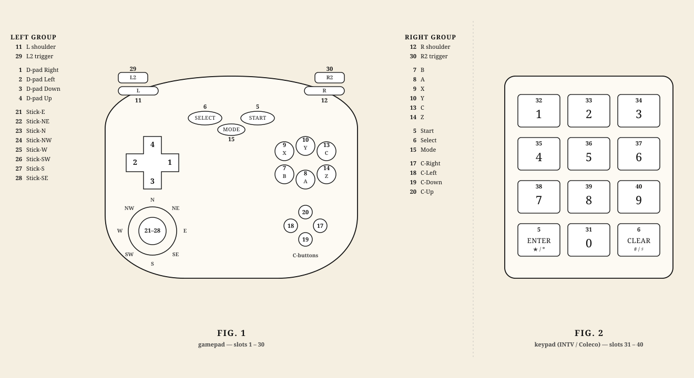

```{r, include = FALSE}
knitr::opts_chunk$set(
  collapse = TRUE,
  comment  = "#>",
  fig.width  = 7,
  fig.height = 4
)
```

```{r setup}
library(replayr)
```

`replayr` decodes emulator movie ("input log") files into a uniform
in-memory representation so the same downstream code works whether
the file came off an FCEUX recorder, a BizHawk session, or a 2008-era
PSXjin run. This vignette walks through the API on a single bundled
sample.

## Reading a movie

Every reader returns a `replayr_movie` S3 object. Use `read_movie()`
to dispatch on file extension automatically:

```{r}
fp <- system.file("extdata", "sample.fm2", package = "replayr")
mv <- read_movie(fp)
mv
```

The bundled `sample.fm2` is a deterministic synthetic NES controller
stream generated by replayr. It contains no ROM or published movie data.
The `print` method shows that the stream is 3,600 frames long, has two
player slots, uses eight universal-button slots, and lists every button
slot that player 1 holds at least once.

## The `replayr_movie` object

Underneath the print method, every parsed movie is just a list:

```{r}
str(mv, max.level = 1L, give.attr = FALSE)
```

* `header` — named list of header keys (e.g. `version`, `emuVersion`,
  `romFilename`, `rerecordCount`). Plus a synthetic `_format` entry
  that records which parser produced the movie.
* `commands` — integer vector of length `n_frames`. Per-frame
  commands byte (Reset, Power, format-specific bits). Most movie
  frames are 0.
* `inputs` — logical 3D array, dimensions
  `(n_frames, n_players, n_buttons)`. `TRUE` means the button was
  held that frame.
* `source_path` — where the movie was loaded from.
* `button_mnemonics` / `button_names` — single-character and
  human-readable labels for the third dimension.

Three helpers tell you the array's shape without poking at `dim()`
directly:

```{r}
c(n_frames(mv), n_players(mv), n_buttons(mv))
```

## Inspecting one player

`player()` extracts a single player's frames as a 2D logical matrix
with named columns:

```{r}
p1 <- player(mv, 1L)
dim(p1)
head(p1)
```

`press_counts()` is the typical first thing you want — total frames
each button was held:

```{r}
press_counts(mv, 1L)
```

The counts expose the fixture's repeating movement and button-pulse
patterns. This deliberately simple signal makes parser regressions easy
to spot without depending on gameplay from a third-party movie.

## A quick visual

A press-rate barplot makes the same data immediately legible:

```{r press-rate}
counts <- press_counts(mv, 1L)
rates  <- counts / n_frames(mv)
barplot(rates,
        las = 2,
        ylab = "fraction of frames held",
        main = "Player 1 press rate by button")
```

## The universal button layout

The `inputs` array's third dimension is always a prefix of a
single 40-slot universal-button alphabet. Slots 1..8 are NES-shaped
(Right, Left, Down, Up, Start, Select, B, A); higher slots cover the
features other consoles add (SNES X / Y / shoulders, Genesis
C / Mode, N64 C-buttons, an 8-direction stick quantisation, PSX
L2 / R2). Slots 31..40 are the Intellivision / ColecoVision numeric
keypad (digits 0-9):



INTV's *Enter* / *Clear* and Coleco's *Star* / *Pound* are not given
their own slots — they fold into Start (slot 5) and Select (slot 6),
since on those platforms they're pressed once at boot rather than as
gameplay verbs.

```{r}
data.frame(slot = seq_along(universal_buttons()),
           mnemonic = universal_buttons(),
           label = universal_button_names())
```

A platform fills only the slots it needs:

| Platform / format(s)            | `n_buttons` |
|---------------------------------|-------------|
| NES (.fm2, .fcm, .bk2-NES)      | 8           |
| Game Boy / GBC (.vbm, .lsmv-GB) | 8           |
| GBA (.vbm-GBA, .bk2-GBA)        | 12          |
| SNES (.smv, .lsmv, .bk2-SNES)   | 12          |
| Sega Master System (.bk2-SMS)   | 12          |
| Sega Genesis (.gmv)             | 15          |
| Sega Saturn (.bk2-SAT)          | 15          |
| PC Engine / TG-16 (.bk2-PCE)    | 15          |
| Arcade (.bk2-MAME)              | 15          |
| N64 (.m64, .bk2-N64)            | 28          |
| GameCube (.dtm)                 | 28          |
| PSX (.pxm, .pjm, .bk2-PSX)      | 30          |
| ColecoVision (.bk2-Coleco)      | 40          |
| Intellivision (.bk2-INTV)       | 40          |

This is what makes cross-platform analysis tractable: the same
column index always means "B button", whether the source movie was
.fm2, .smv, or .pjm.

## Reading other formats

Every supported extension dispatches through the same entry point:

```{r}
supported_formats()
```

Bundled samples live next to the FM2 one:

```{r}
bundled <- list.files(system.file("extdata", package = "replayr"),
                      pattern = "^sample\\.", full.names = TRUE)
basename(bundled)
```

Try one for any format — the API is identical:

```{r}
mv_bk2 <- read_movie(system.file("extdata", "sample.bk2", package = "replayr"))
mv_bk2
press_counts(mv_bk2, 1L)
```

This synthetic BK2 fixture declares an NES controller, so it uses the
same eight-slot layout as the FM2 fixture even though the container
format is different. That makes it useful for checking that two readers
produce equivalent button semantics from independently encoded inputs.
