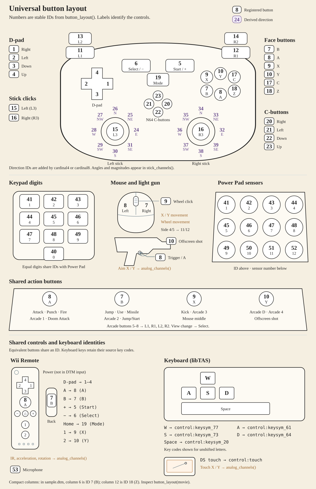

```{r, include = FALSE}
knitr::opts_chunk$set(
  collapse = TRUE,
  comment  = "#>",
  fig.width  = 7,
  fig.height = 4
)
```

```{r setup}
library(replayr)
```

Emulator movies record the inputs used during play. `replayr` reads their
buttons, keys, numeric device channels, and timing fields into S3 objects for
analysis in R. This vignette starts with an artificial NES recording, then
shows how to inspect analogue sticks, mouse movement, and Wii motion fields.
All examples are original recordings supplied with the package.

## Reading a movie

Assigned controller recordings use the S3 class `replayr_movie`. Ordered
polls with unknown ports and heterogeneous device polls use
`replayr_poll_stream`. Use `read_movie()` to dispatch on the file extension:

```{r}
fp <- system.file("extdata", "sample.fm2", package = "replayr")
mv <- read_movie(fp)
mv
```

The bundled `sample.fm2` contains repeating directional movement and button
pulses for two NES controllers.
The `print` method shows that the stream is 3,600 frames long, has two
player slots, uses eight compact button columns, and identifies its source file.

## The `replayr_movie` object

The object is an S3 list containing the imported input and metadata:

```{r}
str(mv, max.level = 1L, give.attr = FALSE)
```

* `header` — named list of header keys (e.g. `version`, `emuVersion`,
  `romFilename`, `rerecordCount`). Plus a synthetic `_format` entry
  that records which parser produced the movie.
* `commands` — integer vector of length `n_frames`. Per-frame
  commands byte (Reset, Power, format-specific bits). Most movie
  frames are 0.
* `inputs` — logical 3D array, dimensions
  `(n_frames, n_players, n_buttons)`. `TRUE` means the button was
  held that frame.
* `source_path` — where the movie was loaded from.
* `button_mnemonics` / `button_names` — short and
  human-readable labels for the third dimension.

Three helpers return the array's dimensions:

```{r}
c(n_frames(mv), n_players(mv), n_buttons(mv))
```

## Inspecting one player

`player()` extracts a single player's frames as a 2D logical matrix
with named columns:

```{r}
p1 <- player(mv, 1L)
dim(p1)
active <- which(rowSums(p1) > 0L)
head(p1[active, , drop = FALSE])
```

`press_counts()` returns the number of observations in which each control
is active:

```{r}
press_counts(mv, 1L)
```

The counts summarise the time spent on each direction and action in this
example. A long hold contributes once per observation, while a brief press
contributes only for its active interval.

## A quick visual

Dividing these counts by the recording length gives the proportion of
observations for which each control is active:

```{r press-rate}
counts <- press_counts(mv, 1L)
rates  <- counts / n_frames(mv)
barplot(rates,
        las = 2,
        ylab = "fraction of frames held",
        main = "Player 1: proportion of observations held")
```

## Compact controller columns and stable IDs

The matrix has compact columns for the recorded controls. Fixed gamepad
layouts retain unused buttons; event-based recordings expose the controls
present in their events. Stable IDs identify the same control across layouts.

```{r}
button_layout(mv) # column, id, key, mnemonic, name, kind
```

Left and right stick directions, stick clicks, N64 C-buttons, and keypad
digits have distinct identities. `button_layout()` lists the shared registry;
`button_layout(mv)` gives the complete layout for this recording, including
source-specific keyboard and peripheral controls.

The registry contains 53 consecutive IDs. Buttons with comparable roles
share an ID across devices. The main mappings are:

| Source controls | Shared control and ID |
|---|---|
| Arcade Attack, Punch, or button 1; Doom Attack | A (8) |
| Arcade buttons 5–8 | L1, R1, L2, R2 (11–14) |
| Arcade D or button 4 | Y (10) |
| Arcade Jump, Jump/Start, or button 2; Doom Use; missile | B (7) |
| Arcade Kick or button 3 | X (9) |
| GunCon trigger, side A, side B, and offscreen shot | A, B, X, Y (8, 7, 9, 10) |
| Intellivision Top | X (9) |
| Joystick buttons 1–8 | A, B, X, Y, L1, R1, L2, R2 (8, 7, 9–14) |
| Keypad Clear and Enter | Select (6) and Start (5) |
| Keypad digits 0–9 and Power Pad sensors 1–12 | Equal numbers share `numbered_0`–`numbered_12` (40–52) |
| Mouse buttons 4 and 5 | L1 and R1 (11 and 12) |
| Mouse left, right, and middle buttons | A, B, X (8, 7, 9) |
| Neo Geo A, B, C, and D | A, B, X, Y (8, 7, 9, 10) |
| Super Scope trigger, cursor, turbo, and pause | A, B, Mode, Start (8, 7, 19, 5) |
| View change | Select (6) |
| Wii Remote 1/2, +/−, and Home | X/Y (9/10), Start/Select (5/6), and Mode (19) |

Wii Remote D-pad and A/B buttons use the gamepad IDs. Nunchuk C/Z use
17/18, Classic Controller buttons use the corresponding gamepad IDs, and
libTAS Guide uses Mode. The microphone uses ID 53. Genesis and Saturn C
retain ID 17 because those controllers have separate C and X buttons.

These mappings align controller roles; the action performed by a button
still depends on the game. Keyboard keys, keypad Star/Pound, and controls
without a defined counterpart retain qualified source IDs. For example,
an arcade D button uses Y (10), while a libTAS keyboard D keeps
`control:keysym_64`. openMSX device-qualified controls also remain separate,
because its recordings can combine several devices in one input stream.

When multiple source buttons share an ID, the column is active if either
is pressed. `source_inputs` and `source_layout` preserve the separate
states and their mapping whenever aliases are combined. Wii device states
also appear in `poll_fields` as `wii_remote_*` and `wii_classic_*` columns,
which `polls()` includes for unassigned streams.



Use `align_buttons(list(movie1, movie2))` before comparing different controller
layouts. It explicitly fills absent controls with FALSE and returns matrices
with the same column identities. For comparisons of game actions, supply a
justified action mapping instead of assuming common physical buttons perform
the same action.

## Reading other formats

The package has readers for 34 recording formats, with HGM as an additional
extension alias for Hourglass WTF. Published-file checks cover 61 TASVideos
platform labels:

| Family | Platforms represented in the checked recordings |
|---|---|
| Arcade and application platforms | Adobe Flash; Android; Arcade; IBM PC compatible; IBM PC DOS; Java 2 Platform, Micro Edition (J2ME); Mac OS / macOS; PICO-8; TIC-80; Web. |
| Atari | Atari 2600; Atari 7800; Atari Jaguar; Atari Jaguar CD; Atari Lynx. |
| Home computers and calculators | Amiga; Apple II; Commodore 64; MSX Home Computer System; Spectravideo SVI-318/328; Texas Instruments TI-83 Series; ZX Spectrum. |
| NEC | NEC PC-98; PC Engine / TurboGrafx-16; PC Engine CD / TurboGrafx-CD; PC-FX; SuperGrafx. |
| Nintendo | Famicom Disk System; Game Boy; Game Boy Advance; Game Boy Color; Nintendo 3DS; Nintendo 64; Nintendo 64DD; Nintendo DS; Nintendo DSi; Nintendo Entertainment System / Famicom; Nintendo GameCube; Satellaview; Super Game Boy; Super Nintendo / Super Famicom; Virtual Boy; Wii. |
| Other consoles | 3DO; CD-i; ColecoVision; Fairchild Channel F; Intellivision; Neo Geo Pocket; Odyssey 2 / Videopac; Sony PlayStation; Uzebox; Vectrex; WonderSwan. |
| Sega | Game Gear; Sega 32X; Sega CD / Mega-CD; Sega Genesis / Mega Drive; Sega Master System; Sega Saturn; Sega SG-1000. |

These are the archive's game-platform labels. Some recordings capture a host
application, such as MAME or Ruffle under libTAS, so their key codes describe
that application. Linux and Windows games are represented under IBM PC
compatible. The [compatibility catalogue](https://github.com/tp451/replayr/blob/main/COMPATIBILITY.md)
lists every platform–format combination, the accepted versions and controller
layouts within each format, and the evidence for each claim.

For example, FM2 and FM3 support text and binary FCEUX input logs; BKM and early
TAS use BizHawk's older field order, while BK2, GBMV, and TASPROJ use named
fields in ZIP containers. PlayStation PXM and PJM distinguish digital pads
from analogue controllers with L3/R3 and two sticks. File extension alone is
therefore only the first step in choosing a decoder.

Every supported extension dispatches through the same entry point:

```{r}
supported_formats()
```

Bundled samples live next to the FM2 one:

```{r}
bundled <- list.files(system.file("extdata", package = "replayr"),
                      pattern = "^sample\\.", full.names = TRUE)
basename(bundled)
```

The button helpers work with a BK2 recording in the same way:

```{r}
mv_bk2 <- read_movie(system.file("extdata", "sample.bk2", package = "replayr"))
mv_bk2
press_counts(mv_bk2, 1L)
```

This BK2 example records an NES controller. It therefore has the same eight
control columns as the FM2 example, allowing their matrices to be compared
without rearranging columns.

## Analogue sticks and numeric channels

`analog_channels(movie, 1L)` preserves the numeric source channels, including
X/Y axes, triggers, and supported peripheral values. The default `analog = "raw"`
keeps them separate from digital button states. Choose a representation for
each stick explicitly:

```{r}
path <- system.file("extdata", "sample.dtm", package = "replayr")
movie <- read_movie(path, analog = c(left = "angle+magnitude", right = "cardinal8"))
head(analog_channels(movie)) # original values in source units
head(stick_channels(movie)) # selected angles, magnitude, and direction centres
button_layout(movie)
```

The four options are `cardinal4`, `cardinal8`, `angle`, and `angle+magnitude`.
A scalar applies to both sticks; a named left/right pair configures them
independently. Cardinal modes add four or eight separate direction columns
per present stick. Angle modes retain continuous directions in degrees:
right 0, up 90, left 180, down 270. A neutral angle is NA. Magnitude is the
Euclidean length of centred, range-normalised X/Y axes; diagonal values can
exceed one.

`deadzone` accepts a scalar or named left/right values in [0,1]. It is a radial
threshold: default 0.25 for PSX/BK2 and 0.125 for M64/DTM. A boundary between
sectors selects the counterclockwise centre. DTM analogue triggers remain
numeric unless `triggers = "digital"` is requested (threshold 128).

Stick conversion covers M64/GZM and BKM N64 axes, GameCube DTM, supported Wii
extensions, analogue PSX PXM/PJM, CTM Circle Pad/C-stick polls, libTAS gamepads,
and identified BK2 N64, PSX, Saturn 3D-pad, and 3DS controllers. BK2 accounts
for different Nyma and Octoshock conventions. A recognised calibration supplies
the centre, range, and vertical orientation. Other numeric channels remain
available through `analog_channels()` in their source units; requesting stick
conversion for an unknown calibration raises an error.

BK2 N64 files may log Boolean stick overrides as well as numeric axes.
The selected representation follows the emulator's override precedence and
version-specific range. Numeric log values remain unchanged; the Boolean
source controls are retained in `movie$stick_overrides`.

Use `button_layout()` to translate between a recording's compact columns and
stable control IDs. Choose `cardinal4`, `cardinal8`, `angle`, or `angle+magnitude`
when the analysis needs derived stick representations; the default keeps raw X/Y.

## Unassigned controller polls

Multi-controller M64 and DTM files retain their ordered polls in an S3 object of class
`replayr_poll_stream`. Each row has `port = NA` because the format stores no
per-poll port label. Numeric channels, digital controls, commands, and original
record bytes remain accessible. A verified repeating polling order can be
supplied through `controller_order` when player assignment is needed.

```{r unassigned-polls}
path <- system.file("extdata", "paper", "unassigned.dtm", package = "replayr")
polls(read_dtm(path, analog = "angle+magnitude"))
```

## Additional input devices and timing

Keyboard support includes libTAS, Hourglass, JPC-RR, openMSX, and the relevant
BizHawk cores. Mouse coordinates and movement come from libTAS, JPC-RR,
openMSX, BizHawk, or Dustmod; Hourglass records Windows virtual-key states,
including mouse-button virtual keys when used. DS/DSi and 3DS recordings add
touch input, and Dolphin Wii reports add pointing and motion channels. `analog_channels()` retains
numeric fields in their original units. Source timing fields accompany event
logs, so an event count should not be converted to seconds using a video rate.
The individual reader help pages describe their observation units.

LSMV recordings can contain several input observations per video frame.
The reader retains every row, so `n_frames(movie)` counts input observations
and `movie$header$frameCount` counts video-frame starts. `movie$subframes`
provides `source_frame`, `subframe`, and `frame_start` for relating each input
to its video frame, along with source-line and reset information. Extended
SNES buttons and the full SNES-side layout of Super Game Boy recordings remain
available. A declared Super Scope supplies trigger, cursor, turbo, and pause
states and signed `gun_x`/`gun_y` coordinates in source units.

openMSX events distinguish relative trackball and paddle movement from absolute
touchpad coordinates. JoyMega buttons, JoyHandle buttons and wheel values,
and the Arkanoid dial retain their recorded identities. Gunstick and Terminator
Laser events provide trigger and light-sensor states, with the complete port
status in numeric channels. Their light sensors use different polarities;
these events describe a detected screen response rather than an aim position.
The original `peripheral-events.omr` example exercises these distinctions.

Controls outside the core gamepad registry have qualified textual IDs.
For example, a KeySym and a Windows virtual-key code retain different names.
`button_layout(movie)` identifies both the core controls and those additional
keys. A mnemonic may contain several characters; code should work with matrix
columns or stable keys rather than split column names into characters.

For CTM and mixed-controller DTM, `polls()` exposes the device and observation
flags beside the inputs. Use those flags to select observations of the device
being analysed. The `poll_bytes` component retains source records for checking
fields that require additional emulator context.

## A mouse drag and Wii motion fields

The artificial Saturn mouse recording moves the pointer, holds the left
button while dragging for 60 observations, releases it, and moves back.
Its two numeric fields are relative motion per observation. The active rows
can be inspected alongside the movement values:

```{r mouse-drag}
path <- system.file("extdata", "paper", "mouse-drag.bk2", package = "replayr")
mouse <- read_movie(path)
layout <- button_layout(mouse)
left <- player(mouse)[, layout$column[layout$key == "a"]]
movement <- analog_channels(mouse)
head(data.frame(observation = which(left), movement[left, , drop = FALSE]))
```

The Wii example contains a pointing sweep with A held, an acceleration pulse,
and changes in the three MotionPlus axes. Selected observations show how these
fields vary independently:

```{r wii-motion}
path <- system.file("extdata", "paper", "wii-motion.dtm", package = "replayr")
wii <- read_movie(path)
motion <- analog_channels(wii)
motion[c(1, 61, 121, 141),
       c("ir1_x", "ir1_y", "accel_x", "gyro_pitch", "gyro_roll",
         "gyro_yaw", "gyro_yaw_slow")]
```

`ir1_x` and `ir1_y` are coordinates for the first IR camera point. The value
pair 1023, 1023, with size 15, denotes an absent point. MotionPlus pitch, roll,
and yaw fields are 14-bit counts; the accompanying `*_slow` flags identify
their range. Wii acceleration channels contain decoded device counts, with
the recorded nine-bit Y/Z values expanded according to Dolphin's convention.
Converting these values to physical units requires device calibration.
Estimating orientation also requires observation timing and a method for
combining the motion measurements.

In real recordings a report may update only some devices. Wii poll metadata
gives `report_id`, `valid_report`, and, where relevant, `core_present`.
Unobserved numeric fields use `NA`. Mixed GameCube/Wii streams also identify
`observed_gc` and `observed_wii`. Unknown reports have `valid_report = FALSE`
and retain their payloads in `poll_bytes`. A known device family can still
have an unknown physical port when several ports of that family are enabled.

## Download archives and long recordings

`movie_members(path)` lists recognised input recordings inside a ZIP download.
If the archive contains several movies, select one explicitly with
`read_movie(path, member = "the-recording.fm2")`. Archive extraction verifies
checksums and uses a private temporary directory.

`read_bk2_chunks(path, FUN)` reads a long BizHawk input log in bounded chunks.
The callback receives the same S3 representation as `read_bk2()`, with source
observation positions in the header. The input log is verified and extracted
once, requiring temporary disk space for the expanded log. The callback can
return per-chunk counts or save results elsewhere without retaining the complete
input array in memory. The ordinary BK2 and LSMV readers use a 256 MiB default
limit on the expanded log, with an explicit `max_input_bytes` override.
